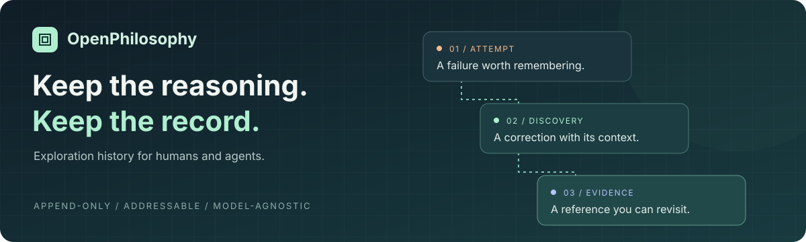
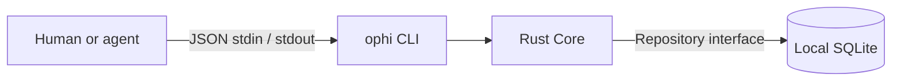

<p align="center">
  
</p>

<p align="center">
  <a href="https://github.com/fuyangg/openphilosophy/actions/workflows/ci.yml"></a>
  <a href="LICENSE"></a>
  
  
</p>

<p align="center">
  <strong>Keep the reasoning. Keep the record.</strong><br />
  Local-first, append-only exploration history for humans and agents.
</p>

<p align="center">
  <a href="#quick-start">Quick start</a> ·
  <a href="docs/cli.md">CLI guide</a> ·
  <a href="examples/mathematics/README.md">Casson invariant example</a> ·
  <a href="spec/v0.1.md">Specification</a>
</p>

---

OpenPhilosophy preserves the failures, discoveries, and evidence behind an investigation. Write a record today, then retrieve its original content and references in a later session. The Rust core works without an LLM or an external service.

### Built around the history

| Principle | What it means |
| --- | --- |
| **Append-only** | Corrections become new entries. Earlier records remain addressable. |
| **Addressable** | Stable IDs and explicit references connect a finding to its evidence. |
| **Local-first** | SQLite transactions keep each write atomic in a local database. |
| **Model-agnostic** | Open entry kinds and a JSON CLI work with human or agent workflows. |

**Development preview:** Rust Core, SQLite storage, and the CLI are implemented. TypeScript SDK, MCP, REST API, and Web UI are planned.

## Quick start

Requires Rust stable and a C compiler to build the bundled SQLite library.

```bash
git clone https://github.com/fuyangg/openphilosophy.git
cd openphilosophy
cargo install --path crates/ophi-cli --locked
ophi --help
```

Create an investigation and copy `data.id` from the response:

```bash
ophi --db ./ophi.db case create --title "Investigate intermittent timeouts"
```

Replace `<case-id>` below, then append a record:

```bash
ophi --db ./ophi.db entry append <<'JSON'
{
  "case_id": "<case-id>",
  "kind": "failure",
  "content": "Increasing the request timeout did not prevent connection pool exhaustion.",
  "author": "human",
  "references": []
}
JSON
```

Open another terminal or return in a later session with the same database file:

```bash
ophi --db ./ophi.db entry get <entry-id>
ophi --db ./ophi.db case history <case-id> --limit 100
```

To revise a finding, append a new entry with a reference such as
`{"target_id":"<old-entry-id>","relation":"supersedes"}`. The original stays intact.

## Try an exploration

### Mathematics: the Casson invariant

Follow a small calculation through an incorrect attempt, a correction, and a separate arithmetic check:

```bash
python3 examples/mathematics/casson_invariant.py --db ./casson.db
```

Using the stated surgery convention, the example obtains **0 for the unknot control** and **1 for +1 surgery on the right-handed trefoil**. It checks the arithmetic and the stored history; it does not prove the surgery theorem. See the [assumptions and walkthrough](examples/mathematics/README.md).

### Debugging: connection pool exhaustion

```bash
python3 examples/debugging/demo.py
```

Both examples use Python 3's standard library and start a new CLI process for every operation.

## How it fits together



| Location | Responsibility |
| --- | --- |
| [`crates/ophi-core`](crates/ophi-core) | Records, validation, references, and transactional persistence |
| [`crates/ophi-cli`](crates/ophi-cli) | Command parsing and the versioned JSON interface |
| [`spec`](spec) | Record semantics and the public JSON Schema |
| [`examples`](examples) | Runnable investigations |

Core generates IDs and UTC timestamps. References must target existing entries in the same Case. History follows append order. Input is strict JSON with a 1 MiB request and record limit. Entry kinds do not imply truth: `proof_submitted` never automatically becomes `verified`.

Read the [CLI guide](docs/cli.md), [history and protocol specification](spec/v0.1.md), and [record schema](spec/record.schema.json) for details.

## Development

```bash
cargo fmt --check
cargo clippy --workspace --all-targets --locked -- -D warnings
cargo test --workspace --locked
cargo build --bin ophi --locked
PATH="$PWD/target/debug:$PATH" python3 examples/mathematics/casson_invariant.py
cargo install cargo-audit --locked
cargo audit
```

CI also runs both examples. Tests cover persistence, rejected overwrites, reference integrity, rollback, concurrent connections, pagination, and malformed input.

The project's crates forbid unsafe Rust; dependencies may use it internally. Database triggers prevent accidental overwrites, but people with write access to the database file can change it. `author` is a caller-supplied label. Manage file permissions and backups accordingly.

## Roadmap

- [x] Rust library, local SQLite storage, and JSON CLI
- [x] Runnable debugging and Casson invariant examples
- [ ] Validate the record model through longer investigations
- [ ] Add explicit export and migration tools
- [ ] Add a TypeScript SDK over the CLI protocol
- [ ] Explore MCP and shared agent workflows

Feedback from real investigations is welcome in [Issues](https://github.com/fuyangg/openphilosophy/issues). Include the command, expected behavior, and a small reproducible example.

## License

[MIT](LICENSE) · OpenPhilosophy contributors
